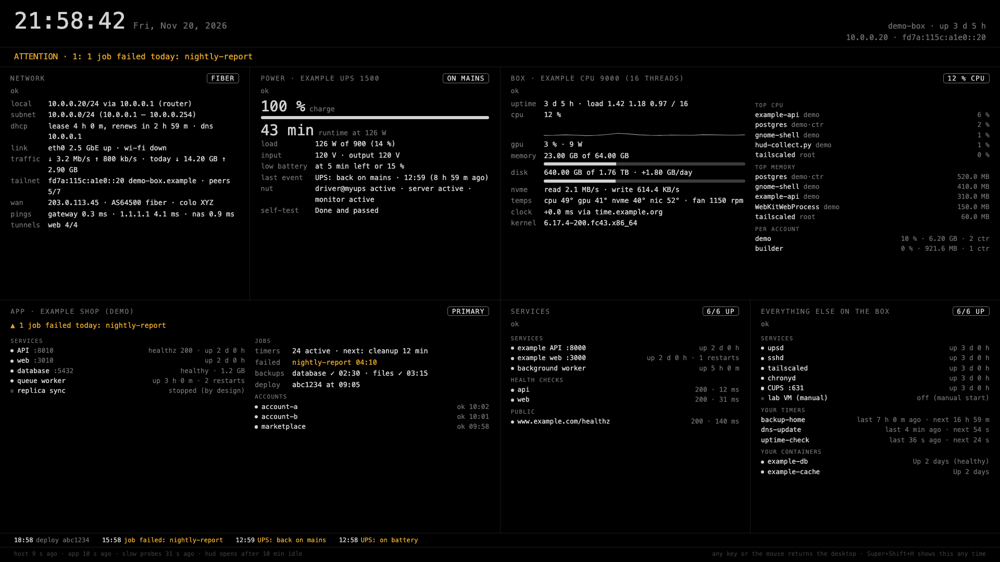

# Framework HUD

A full-screen status display for a Linux workstation that shows up when you walk away. After a set
number of idle minutes, a borderless window covers the monitor with the machine's state: network
and uplink, UPS power, CPU, memory, disk and temperatures, the services you care about, and one
panel for an app of your own. Touch a key or the mouse and it is gone. Nothing locks, nothing is
clicked, and the HUD never changes anything on the machine.

It was built for a Framework Desktop running Fedora and GNOME, hence the name, but nothing in it is
specific to that hardware.



## What it shows

- **Network**: local address, subnet, gateway, DHCP lease countdown, link speed, traffic now and
  today, tailnet address and peers, WAN IP and ASN (and whether you are on your primary or backup
  line), pings, and cloudflared tunnel connections.
- **Power**: UPS status in words, charge, runtime, load, voltages, low-battery thresholds, the last
  UPS event and whether the NUT services are running.
- **Box**: uptime, load, CPU with a ten-minute sparkline, GPU, memory, disk and its fill rate,
  NVMe throughput, temperatures, fan, clock offset, kernel (and whether a reboot is pending), the top
  processes by CPU and memory, and totals per user account.
- **App**: whatever your own collector reports (see below).
- **Services**: your user services, local health URLs and public URLs.
- **Everything else**: system units, your timers, your containers.

Every panel lists its problems first, in amber, as plain sentences; a healthy panel just says "ok".
The strip under the clock gathers every problem into one ATTENTION line, and the strip above the
footer lists the last 24 hours of events.

## Requirements

- Linux with GNOME on Wayland (the idle detection uses Mutter's idle monitor over D-Bus).
- Python 3.10+, PyGObject, GTK 4 and WebKitGTK 6.0. On Fedora:
  `sudo dnf install python3-gobject gtk4 webkitgtk6.0`.
- systemd user services.
- Optional, each only for its own panel lines: NetworkManager (`nmcli`), NUT (`upsc`) for a UPS,
  `tailscale`, `chronyc`, `podman`, `dig` (for the ASN lookup), and cloudflared with its metrics
  listener on localhost.

## Install

```
git clone <this repo> framework-hud
cd framework-hud
sudo ./install.sh
```

`install.sh` copies `hud.py`, `hud.html` and `hud-collect.py` to `/usr/local/lib/framework-hud`,
installs two user units in `/etc/systemd/user`, writes a starter
`~/.config/framework-hud/config.json` if you have none, binds Super+Shift+H to show the HUD on
demand, and enables both units for the user who ran `sudo` (or `HUD_USER`).

Then edit `~/.config/framework-hud/config.json`. `examples/config.example.json` shows every key;
all of them are optional:

| key | what it does |
| --- | --- |
| `nic`, `wifi` | interfaces to watch (default: the one with the default route, and the first `wl*`) |
| `gateway_label` | a word shown after the gateway address |
| `expected_link_mbps` | a slower link than this is a problem line |
| `pings` | `{"name": "host"}` to ping every tick (default: the gateway and 1.1.1.1) |
| `uplink` | `primary_asn`, `primary_label`, `backup_label`, `backup_cap_gb`: tells your main line from a backup one |
| `ups` | the NUT name, e.g. `myups@localhost`; leave it out if you have no UPS |
| `disk_path`, `disk_device` | the filesystem to measure and the block device for throughput |
| `system_units` | `[["unit", "label"], ...]` for the Everything else panel |
| `manual_units` | units that are usually off on purpose (shown dim, never a problem) |
| `user_units` | `[["unit", "label"], ...]` user services for the Services panel |
| `health_checks` | `{"name": "http://127.0.0.1:PORT/healthz"}` |
| `public_urls` | URLs checked every 60 s |
| `user_timers` | which user timers to list; `null` lists the next eight |
| `tunnels` | `{"name": port}` of cloudflared metrics listeners (`--metrics 127.0.0.1:PORT`) |
| `accounts` | `{"user": uid}` for the per-account totals; `null` means every login account |

Restart the collector after editing: `systemctl --user restart framework-hud-collect`.

To change the idle time, edit `HUD_IDLE_MINUTES` in `/etc/systemd/user/framework-hud.service` (or
add a drop-in with `systemctl --user edit framework-hud`).

## How idle detection and wake work

`hud.py` runs in your GNOME session. At start it asks `org.gnome.Mutter.IdleMonitor` for an idle
watch at `HUD_IDLE_MINUTES`. When the watch fires, the window opens fullscreen on the first monitor
and the service asks Mutter for a user-active watch. The first key press or mouse movement fires
that watch and the window hides again (a key handler on the window does the same, as a backstop).
The window is hidden, never destroyed, so the next idle period shows it instantly.

Super+Shift+H sends SIGUSR1 to the service's main process, which shows the HUD at once. A short
grace period keeps the shortcut's own key release from closing it.

The HUD does not lock the screen or change GNOME's blanking, lock or suspend settings. If your
desktop blanks the screen after a few minutes, it blanks over the HUD; turn blanking off (Settings,
Power, Screen Blank: Never) if you want the HUD on the monitor whenever you are away.

The page itself (`hud.html`) fetches `host.json` and `app.json` every 5 s over `file://`; the window
process never runs JavaScript in it.

## Adding a collector

The App panel reads one JSON file, by default `~/.cache/framework-hud/app.json` (change it with
`HUD_APP_JSON` in `framework-hud.service`). Any program that writes that file every few seconds
becomes a panel. `examples/example-collector.py` writes fake data and documents the contract; in
short, every key is optional:

```json
{
  "at": 1767225600,
  "title": "App · My Service",
  "badge": {"text": "PRIMARY", "warn": false},
  "problems": ["replica lag 42 s"],
  "services_title": "services",
  "services": [{"label": "API", "port": 8080, "state": "active", "since": 1767100000, "restarts": 0,
                "detail": "healthz 200", "ok": true, "expected": false}],
  "facts_title": "details",
  "facts": [["version", "1.2.3"], ["queue", "48", true]],
  "list_title": "accounts",
  "list": [{"name": "alpha", "value": "ok", "bad": false}],
  "events": [{"at": 1767220000, "what": "deploy 1.2.3", "kind": "deploy"}]
}
```

- `at` is epoch seconds; data older than 60 s becomes a problem line.
- A service is healthy when `ok` is true, or when `ok` is absent and `state` is `"active"`.
  `expected: true` marks a service that is stopped on purpose.
- A fact with a third element `true` shows in amber.
- `events` join the 24-hour strip; kinds `ups`, `role` and `job` show in amber.

Write the file atomically (write a temp file, then rename) so the page never reads half of it. If
your app runs as a different user whose home the HUD cannot read, have it write under `/run/<name>/`
(create the directory with a tmpfiles.d rule, mode 0755, file 0644) and point `HUD_APP_JSON` there.

To try the page without installing anything:

```
python3 sample-data/make-sample.py
python3 -m http.server 8765 --bind 127.0.0.1
# open http://127.0.0.1:8765/hud.html?host=sample-data/host.json&app=sample-data/app.json
```

## Known limits

- GNOME only: other desktops do not offer Mutter's idle monitor. Another idle source (for example
  `ext-idle-notify` on wlroots compositors) would need a small change in `hud.py`.
- It runs in your session, so after a reboot there is no HUD until someone signs in.
- One App panel. Two apps means one collector that reports both, or a change to the page.
- The collector reads hwmon names it knows (`k10temp`, `coretemp`, `amdgpu`, `nvme`, common NIC
  drivers, `cros_ec`); other sensors show as "–".
- The egress check calls `1.1.1.1` and Team Cymru's DNS once a minute. Leave `uplink` out of the
  config if you do not want the primary/backup verdict; the WAN IP is still fetched.
- The layout is fixed to six panels and sized for a landscape monitor.
- Read-only by design: there are no controls, and there will not be.

## License

MIT. See [LICENSE](LICENSE).
